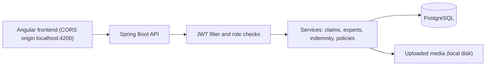

# Insurance Claims Platform

Non-life insurance claims backend: declare a claim, score its priority, assign an expert, track its status and compute the indemnity.

[](https://github.com/Beru47/insurance-claims-platform/actions/workflows/ci.yml)


## Context

Built in 2025 as my final-year project (PFE) at VERMEG, for the engineering degree in Applied Mathematics at ENSIT. The project covered claims management for non-life insurance: declaration, tracking and indemnification.

This repository holds the Spring Boot backend: claim declaration with media upload, priority scoring, expert assignment, status tracking, indemnity calculation, a dashboard and JWT-based authentication with role checks.

### Scope of this repository

This public snapshot contains the claims and indemnification core; integration modules from the internal project (Kafka events, fraud scoring, Keycloak, Elasticsearch) are not included.

## Features

- **Claim declaration** (`multipart`, with optional media files) tied to a policy, with validation and a generated claim number.
- **Priority scoring**: a logistic score (claim type severity, location risk, description keywords, time-decayed claim history through a gamma CDF, coverage bonus) normalised to 0-100. Score of 80 or more marks the claim `URGENT`, otherwise `PENDING`.
- **Status lifecycle**: `PENDING`, `UNDER_REVIEW`, `SUSPECTED_FRAUD`, `APPROVED`, `REJECTED`, `URGENT`, `IN_PROGRESS`.
- **Expert workflow**: automatic assignment with workload and specialty scoring, assignment preview and analytics, expert reports, meetings, claim approval.
- **Indemnification**: base amount per claim type, severity uplift, adjustment by the client's claim history, payout cap.
- **Roles**: client, expert, manager (gestionnaire), admin, with JWT login and role-based route protection.
- **Dashboard** endpoints and policy / asset management.

## Architecture



## Tech stack

Java 17, Spring Boot 3.5 (Web, Data JPA, Security, OAuth2 resource server, Mail, Validation), PostgreSQL, jjwt, Apache Commons Math (gamma distribution), Lombok, JUnit 5 and Mockito, Maven, GitHub Actions.

## Project structure

```
src/main/java/com/vermeg/sinistpro
  config/      Jackson, CORS, JWT filter
  controller/  REST controllers and request/response DTOs
  service/     Business logic (SinistreService, ExpertService, IndemnificationService, ...)
  model/       JPA entities: Sinistre, Policy, Client, Expert, Report, Meeting, Notification, ...
  repository/  Spring Data JPA repositories
  security/    SecurityConfig, JwtUtil
  exception/   Global exception handler
src/main/resources/application.yml
src/test/java  Unit tests
```

## Run locally

Prerequisites: JDK 17+, Docker (for PostgreSQL).

```bash
cp .env.example .env              # then edit the values
docker compose up -d              # PostgreSQL on localhost:5433
set -a; . ./.env; set +a          # export the variables (Git Bash / Linux / macOS)
./mvnw spring-boot:run            # API on http://localhost:8081
```

Configuration comes from environment variables: `DB_URL`, `DB_USERNAME`, `DB_PASSWORD`, `JWT_SECRET` (base64), `SINISTRE_SECRET_KEY`. Hibernate is set to `create-drop`, so the schema is rebuilt on each start. The claim upload directory is currently hard-coded to `/uploads/`.

## API overview

| Method | Path | Purpose |
|---|---|---|
| POST | `/api/auth/signup`, `/login`, `/admin-login`, `/expert-login` | Register and authenticate, returns a JWT |
| POST | `/api/sinistres/declare` | Declare a claim (multipart: `request` JSON + `mediaFiles`) |
| GET | `/api/sinistres`, `/api/sinistres/{id}` | List claims, get one |
| PATCH | `/api/sinistres/{id}/status` | Update claim status |
| POST | `/api/policies/{clientId}` | Create a policy for a client |
| GET | `/api/policies/{policyId}` | Get a policy |
| POST | `/api/assets/{policyId}` | Add an asset to a policy |
| POST | `/api/indemnisations/calculate/{sinistreId}` | Compute and store the indemnity |
| POST | `/api/experts/assign/{sinistreId}` | Assign the best-scored expert |
| GET | `/api/experts/preview-assignment/{sinistreId}` | Preview expert scores |
| GET | `/api/experts/{expertId}/claims`, `/workload` | Expert's claims and workload |
| POST | `/api/experts/{expertId}/claims/{sinistreId}/report`, `/meeting`, `/approve` | Report, schedule a meeting, approve |
| GET | `/api/experts/analytics/assignments` | Assignment analytics |
| GET | `/api/dashboard/**`, `/api/admin/**` | Dashboard and admin (admin routes require `ROLE_ADMIN`) |

## Testing

```bash
./mvnw verify
```

Unit tests (JUnit 5, Mockito) cover the indemnity rules: base amount, severity uplift, client-history adjustment, invalid policy and unknown claim. The same command runs in GitHub Actions on every push and pull request.

## Roadmap

- Replace `create-drop` with Flyway migrations and make the upload directory configurable.
- Add Testcontainers integration tests.
- Add a Dockerfile and Actuator/Prometheus metrics.
